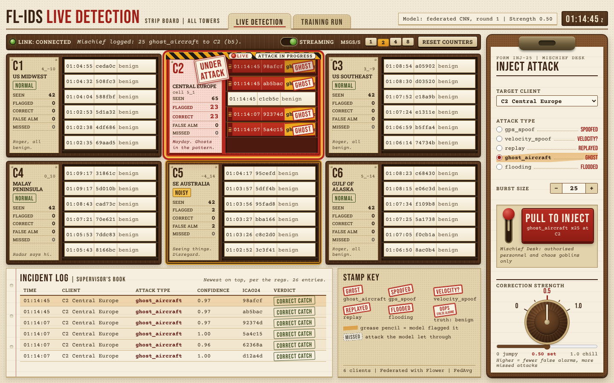
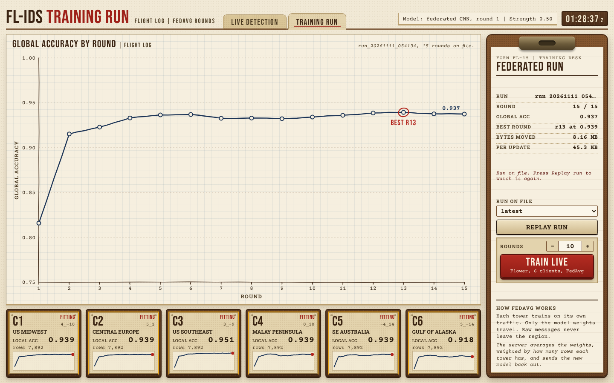

# AeroGuard

Federated intrusion detection for ADS-B surveillance data, with a leakage audit of the
synthetic-attack pipeline and a class-prior correction.

Code accompanying a manuscript currently under review. The paper's title and full
reference will be added once it is published.

## What it does

The pipeline takes real OpenSky Network state vectors from four Mondays of 2019 (one per
quarter) for training and injects five synthetic attacks: GPS spoofing, velocity spoofing,
replay, ghost aircraft and message flooding. Every feature is audited for label dependence,
non-causal computation and construction artifacts; the pipeline is corrected accordingly
(version v3) and a "core" feature set is defined from the audit. A 1-D CNN is trained with
FedAvg across clients defined by geographic region cells and compared with the same CNN
trained centrally on identical rows and with a centralized LightGBM model, all selected on
training-day validation data only and tested on four December Mondays over several seeds. A
Bayesian class-prior correction, estimated from the training days, moves the decisions from
the balanced training mix back toward realistic traffic. All attacks are synthetic, so the
results characterize detection of the specified injection rules, not of real adversaries.

## Repository layout

| Path | Contents |
|---|---|
| `opensky_fl_ids_pipeline.py` | Raw OpenSky CSVs to labelled, feature-engineered data with injected attacks (pipeline v3; `--pipeline-version v2` and `mv` for the ablation) |
| `federated_simulation.py` | Data loading, feature preparation, region-cell clients, models (MLP, CNN, GRU) and the FedAvg loop |
| `federated_simulation_flower.py` | The same federated training orchestrated with Flower (not used for the paper's results) |
| `leakage_audit.py` | Per-feature leakage audit and the audit table |
| `region_lookup_check.py` | Instrumented pipeline run giving exact region re-lookup numbers for the audit |
| `lgbm_baseline.py` | Standalone centralized LightGBM baseline (its parameters are reused by the experiments) |
| `run_revision2.sh` | Resumable driver for the paper's full experiment grid |
| `run_everything.sh` | First-revision driver; still the scripted path for the data checks and the leakage audit |
| `make_share.sh` | Builds the cache share for the optional multi-machine mode |
| `requirements.txt` | Pinned Python dependencies |
| `experiments/` | Experiment harness, run grid, sampling, aggregation into tables, synthetic data and tests |
| `docs/` | Reproduction guide, multi-machine guide, pipeline overview, v3 changes and audit, screenshots |
| `demo/` | Live browser demo of a trained model (not part of the paper's evaluation) |
| `tools/` | Earlier exploratory prior-correction scripts and one-off flooding diagnostics |
| `results/` | The aggregated tables, sweep data and per-run index behind every table and figure in the paper (see [results/README.md](results/README.md)) |
| `LICENSE` | MIT license |

## Requirements and installation

Python 3.12 or 3.13.

```bash
python3 -m venv .venv && source .venv/bin/activate
pip install -r requirements.txt
```

`requirements.txt` pins numpy, pandas, scikit-learn, scipy, joblib, LightGBM, matplotlib and
PyTorch. Install the PyTorch wheel that matches your GPU driver, or the CPU wheel. All
scripts run on the CPU (`--device auto` uses a CUDA GPU when one is present), but the
full grid is practical only on a GPU: one federated CNN run takes about 40 to 60 minutes on
a laptop GPU and several hours on a CPU. The live demo needs the extra packages in
`demo/requirements-demo.txt`.

## Data

OpenSky Network state-vector data is not redistributed here. The study uses the OpenSky
historical state-vector archives (https://opensky-network.org/data/datasets): 24 hourly files
for each of 2019-01-07, 2019-04-01, 2019-06-24 and 2019-09-30 (training) and 2019-12-09,
2019-12-16, 2019-12-23 and 2019-12-30 (test). `docs/REPRODUCING.md` explains how to arrange
them.

OpenSky asks users of its data to cite: M. Schaefer et al., "Bringing up OpenSky: A
large-scale ADS-B sensor network for research", IPSN 2014.

## Quick start

1. Self-test on synthetic data (CPU, about 20 minutes; must end with `SMOKE TEST OK`):

   ```bash
   bash experiments/smoke_test.sh /tmp/aeroguard_smoke
   ```

   `experiments/make_synthetic_data.py --out-dir DIR` writes small labelled files and
   `experiments/make_synthetic_raw.py --out-dir DIR --date 2019-01-07 --hours 2` writes raw
   OpenSky-format hours, if you want synthetic inputs for your own runs.

2. Process raw OpenSky hours into a labelled day file:

   ```bash
   python3 opensky_fl_ids_pipeline.py $RAW_DIR/states_2019-01-07-*.csv --chunk-files 1 \
       --output opensky_2019-01-07_labeled.csv
   ```

3. Run one federated experiment (federated CNN, core features, one seed). `--quick` and
   `--min-client-rows 500` keep it small enough for synthetic or partial data:

   ```bash
   python3 experiments/run_experiments.py --train-files opensky_2019-01-07_labeled.csv \
       --holdout opensky_2019-12-09_labeled.csv --out-dir runs_demo \
       --models fed_cnn --feature-sets core --seeds 1 --quick --min-client-rows 500
   ```

   Each run writes a JSON with validation and test metrics for every correction strength.

## Results in this repository

`results/` holds the aggregated outputs behind every table and figure in the paper, so a
number can be checked without re-running the grid:

- `results/generated/` is the output of `experiments/aggregate_results.py`: the LaTeX tables
  and the `.dat` sweep files plotted in the correction-strength figure.
- `results/runs_index.csv` has one row per run, with the validation-chosen correction
  strength, macro F1, false alarm rate, attack recall and PR-AUC at that strength and at
  full correction, the rounds completed against the cap, and the device used.
- `results/make_runs_index.py` rebuilds that index from the raw run JSONs.

`results/README.md` maps each file to the table or figure it feeds and records the caveats
needed to read the numbers correctly: the runs were produced on three machines, seed counts
differ between models, and most federated runs finished at the round cap. The raw per-run
JSON files are not in this repository because of their size; see `results/README.md` for
where they are archived.

## Reproducing the paper

The full procedure (data, pipeline, leakage audit, experiments, tables, expected time and
disk) is in [docs/REPRODUCING.md](docs/REPRODUCING.md). The headline commands are:

```bash
REV2_W=$WORK_DIR REV2_TARS=$RAW_DIR/tars.txt bash run_revision2.sh start   # resumable; also: status, stop
python3 experiments/aggregate_results.py --runs-dirs $WORK_DIR/runs/main \
    --rev2-root $WORK_DIR/runs --tex-dir $WORK_DIR/generated
```

## Attack types

Each attack takes a disjoint 2% slice of the rows of every chunk (`--rate`); magnitudes are
drawn per row. Rules as implemented in `opensky_fl_ids_pipeline.py` (v3):

| Attack | Injection rule |
|---|---|
| `gps_spoof` | Latitude and longitude each shifted by up to 0.05, 0.5 or 2.0 degrees (severity drawn with probabilities 0.34, 0.33, 0.33); region cell and regional baseline re-looked-up |
| `velocity_spoof` | Ground speed multiplied by a factor in [1.1, 8.0]; vertical rate increased by 5 to 40 m/s |
| `replay` | `time` and `lastcontact` moved back by 2 to 899 s (`lastposupdate` unchanged) |
| `ghost_aircraft` | ICAO 24-bit address replaced by a random address in the range f00000 to fffffe |
| `flooding` | Message duplicated 2 to 10 times at offsets of k times 0.01 to 0.5 s; only the duplicates are labelled flooding, the original stays benign |

Kinematic features are recomputed after injection for every affected aircraft. See
[docs/pipeline.md](docs/pipeline.md) and [docs/PIPELINE_V3_CHANGES.md](docs/PIPELINE_V3_CHANGES.md).

## Live demo

`demo/` is a browser demo in which six regional receivers stream held-out messages, a trained
model scores each one, and attacks can be injected and the correction strength turned live; a
second view replays or runs a small Flower training. It is a visualisation of a trained model,
not part of the paper's evaluation. See [demo/README.md](demo/README.md).





The screenshots come from the demo's integration test on synthetic data.

## Tests

`experiments/smoke_test.sh` runs the whole test suite on synthetic data: sampler, pipeline
variants, protocol regression against the frozen round-1 harness, FedProx and resume, the
cache-only mode, the shard files, a simulated `run_revision2.sh` pass with stops and kills, a
simulated multi-machine run and the aggregation. The individual tests are listed in
[docs/REPRODUCING.md](docs/REPRODUCING.md#8-tests). The demo has its own test:
`python3 demo/tools/test_server.py`.

## License

MIT, see [LICENSE](LICENSE).

## How to cite

Reference details will be added once the accompanying paper is published.
